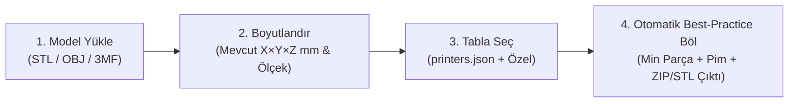
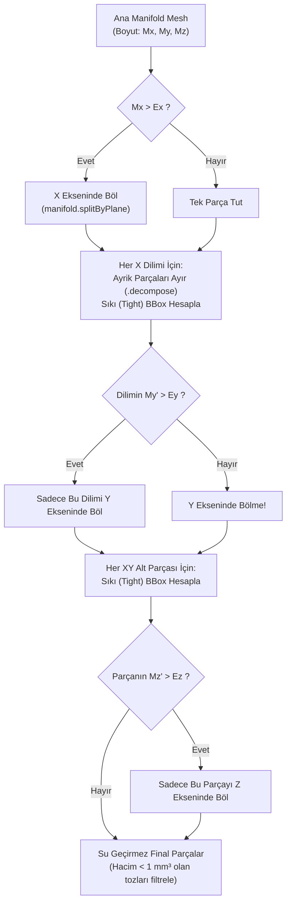

# SpliD — Cross-Platform Automatic 3D Model Splitter (Implementation Plan)

> [!IMPORTANT]
> **Amacı ve Kapsamı:** Bu plan, `3dsplitter.com` gibi karmaşık manuel araçların aksine **4 adımlı, sıfır sürtünmeli (zero-friction)** bir masaüstü iş akışı sunan **SpliD** (Electron + React + TypeScript + Three.js + `manifold-3d` WASM) uygulamasını uçtan uca inşa etmek için hazırlanmıştır.
> Plan, **Gemini Hydrogen** modeliyle `/goal` komutu altında **tam otonom** çalıştırılabilecek şekilde; dosya ağacı, veri şemaları, matematiksel algoritmalar, kod şablonları ve her fazın otomatik doğrulama (`Definition of Done`) adımlarıyla birlikte kurgulanmıştır.

---

## 1. Ürün Vizyonu ve 4 Adımlı Temel İş Akışı



1. **Adım 1 — Model Seçimi (Browse / Drag & Drop):**
   - Kullanıcı `.stl`, `.obj` veya `.3mf` dosyasını seçer.
   - Uygulama anında modeli merkeze hizalar, **mevcut boyutlarını (`X × Y × Z mm`)**, hacmini ($\text{cm}^3$) ve üçgen (triangle) sayısını ekranda gösterir.
2. **Adım 2 — Hedef Boyut Ayarlama (Smart Scaling):**
   - Kullanıcı hedef `X`, `Y` veya `Z` milimetre değerini ya da `%` ölçek oranını girer.
   - **En-Boy Oranı Kilidi (Aspect Ratio Lock)** varsayılan olarak açıktır; tek bir eksen değiştirildiğinde diğer iki eksen orantılı güncellenir.
   - Birim kurtarma kısayolları (`Inch -> mm (×25.4)`, `cm -> mm (×10)`) tek tıkla çalışır.
3. **Adım 3 — 3D Yazıcı Tabla Seçimi (`printers.json`):**
   - Piyasadaki tüm popüler FDM ve reçine (SLA/MSLA) yazıcıları içeren kapsamlı `printers.json` listesinden marka/model seçilir (veya `Custom / Özel Boyut` girilir).
   - Seçilen yazıcının tabla hacmi (`Build Volume X × Y × Z mm`) 3D sahnede yarı saydam kafes (wireframe box) olarak modelin etrafında gösterilir.
4. **Adım 4 — Otomatik "Best-Practice" Bölme ve Dışa Aktarma:**
   - Tek tıkla çalışan **Hierarchical Adaptive KD-Split** motoru; modeli seçilen tablaya **en az parça sayısıyla**, **ince/kırılgan parça (sliver) bırakmadan**, **en düşük kesit alanından (seam minimization)** ve **su geçirmez (watertight/manifold)** olarak böler.
   - Kesim yüzeylerine otomatik **hizalama pimi yuvaları (dowel holes)** açar ve basılabilir `connector_pin.stl` dosyasını üretir.
   - Parçaları 3D sahnede patlatılmış görünümle (Exploded View slider) renkli gösterir ve tek tıkla `.zip` veya klasör halinde `.stl` olarak dışa aktarır.

---

## 2. Teknoloji Yığını ve Mimari Kurallar (Gemini Hydrogen İçin Kesin Kısıtlar)

> [!CAUTION]
> **Gemini Hydrogen Otonom Yürütme Kuralları:**
> 1. **CSG Kütüphanesi:** Kesinlikle `manifold-3d` (WebAssembly) kullanılacaktır. `three-csg-ts` veya eski BSP tabanlı CSG kütüphaneleri açık yüzey (non-manifold mesh) bıraktığı ve büyük STL'lerde kilitlendiği için **kullanılmamalıdır**.
> 2. **Worker İzolasyonu:** Ağır 3D boolean kesim işlemleri UI thread'ini dondurmamak için bir **Web Worker** (`src/renderer/src/workers/splitter.worker.ts`) içinde çalıştırılacaktır.
> 3. **Birim Standardı:** Uygulama içindeki tüm geometrik hesaplamalar **milimetre (`mm`)** cinsindendir ve Z ekseni yukarı (`Z-up`, 3D baskı standardı) kabul edilir.

| Katman | Teknoloji / Paket | Versiyon / Rol |
| :--- | :--- | :--- |
| **Masaüstü Çatısı** | `electron` + `electron-vite` + `electron-builder` | Cross-platform (Windows, macOS, Linux) |
| **Frontend UI** | `react` (v18) + `typescript` + `tailwindcss` + `lucide-react` | Hızlı, karanlık mod (dark-first) CAD arayüzü |
| **State Yönetimi** | `zustand` | Model, ölçek, yazıcı, kesim planı ve parça durumu |
| **3D Görselleştirme** | `three` + `@types/three` + `@react-three/fiber` + `@react-three/drei` | 3D sahne, tabla önizleme, kesim düzlemleri, Exploded View |
| **Geometri & CSG Motoru** | `manifold-3d` (WASM) | Su geçirmez (watertight) düzlemsel kesim (`splitByPlane`) ve pim yuvası (`subtract`) |
| **Dosya Okuma / Yazma** | Three.js `STLLoader`, `OBJLoader`, `ThreeMFLoader` + `fflate` | STL/OBJ/3MF okuma, Binary STL üretimi ve ZIP paketleme |
| **Test Altyapısı** | `vitest` | Algoritma, `printers.json` ve CSG motoru birim testleri |

---

## 3. Proje Dizin Yapısı (`d:\Works\2026\SpliD`)

```text
d:\Works\2026\SpliD\
├── electron.vite.config.ts
├── package.json
├── tsconfig.json
├── tsconfig.node.json
├── tsconfig.web.json
├── tailwind.config.js
├── postcss.config.js
├── resources/
│   └── icon.png
├── src/
│   ├── main/
│   │   ├── index.ts                  # Electron Main Process & pencere yönetimi
│   │   └── ipcHandlers.ts            # Dosya açma/kaydetme native dialog IPC'leri
│   ├── preload/
│   │   ├── index.ts                  # contextBridge API (window.splidAPI)
│   │   └── index.d.ts                # Preload TypeScript tanımları
│   ├── shared/
│   │   ├── types.ts                  # Ortak veri modelleri (Printer, MeshStats, SplitPlan, SplitPart)
│   │   └── data/
│   │       └── printers.json         # Genel geçer tüm 3D yazıcıların tabla boyutları veritabanı
│   └── renderer/
│       ├── index.html
│       └── src/
│           ├── main.tsx
│           ├── App.tsx
│           ├── assets/
│           │   └── main.css
│           ├── store/
│           │   └── useAppStore.ts    # Zustand merkezi state
│           ├── core/
│           │   ├── meshLoader.ts     # STL, OBJ, 3MF buffer -> Float32Array (vertices) & Uint32Array (indices)
│           │   ├── meshTransform.ts  # Bounding box, merkeze hizalama (Z=0 taban), ölçekleme (scaling)
│           │   ├── optimalPlanner.ts # Best-Practice Hierarchical Adaptive KD-Split düzlem hesaplayıcı
│           │   ├── csgEngine.ts      # manifold-3d ile kesim + hizalama pimi yuvası açma + pin üretimi
│           │   └── stlExporter.ts    # Binary STL serileştirici ve fflate ile toplu ZIP oluşturucu
│           ├── workers/
│           │   └── splitter.worker.ts # optimalPlanner + csgEngine'i arka planda çalıştıran Web Worker
│           └── components/
│               ├── TopBar.tsx        # Uygulama başlığı, hızlı istatistikler, sıfırlama
│               ├── Step1FileLoad.tsx # Dosya seçimi ve mevcut boyut kartı
│               ├── Step2Scale.tsx    # X/Y/Z mm inputları, oran kilidi, birim dönüşüm butonları
│               ├── Step3Printer.tsx  # Marka/Model arama ve seçimi, güvenlik payı (margin) ayarı
│               ├── Step4Split.tsx    # Otomatik böl butonu, pim ayarları, parça listesi ve ZIP/STL kayıt
│               └── Viewport3D.tsx    # Three.js sahnesi, tabla kutusu, kesim düzlemleri, Exploded View slider
└── tests/
    ├── printers.test.ts              # printers.json şema ve veri doğrulama testleri
    ├── optimalPlanner.test.ts        # En az parça, anti-sliver ve kesit optimizasyonu testleri
    └── csgEngine.test.ts             # manifold-3d su geçirmez kesim ve STL export testi
```

---

## 4. Ortak Veri Yapıları ve `printers.json` Şeması

### 4.1. `src/shared/types.ts`

```typescript
export type PrinterTechnology = 'FDM' | 'SLA';

export interface PrinterProfile {
  id: string;
  brand: string;
  model: string;
  technology: PrinterTechnology;
  buildVolume: {
    x: number; // mm
    y: number; // mm
    z: number; // mm
  };
  popular?: boolean;
}

export interface Vector3MM {
  x: number;
  y: number;
  z: number;
}

export interface BoundingBoxMM {
  min: Vector3MM;
  max: Vector3MM;
  size: Vector3MM;
}

export interface RawMeshData {
  fileName: string;
  positions: Float32Array; // [x0, y0, z0, x1, y1, z1, ...]
  indices: Uint32Array;    // [i0, i1, i2, ...]
  originalSize: Vector3MM;
  triangleCount: number;
}

export interface CutPlane {
  id: string;
  axis: 'x' | 'y' | 'z';
  position: number;        // mm (kesim koordinatı)
  normal: [number, number, number];
  crossSectionAreaMM2: number;
  depthLevel: number;      // Hiyerarşik KD-Split derinliği (0: X, 1: Y, 2: Z)
}

export type ConnectorMode = 'adaptive' | 'standard-pin' | 'filament-pin' | 'none';

export interface ConnectorConfig {
  enabled: boolean;
  mode: ConnectorMode;     // Varsayılan: 'adaptive' (kalınlığa göre 4mm / 1.75mm filament / atla)
  diameterMM: number;      // Standart pim çapı, varsayılan: 4.0 mm
  depthMM: number;         // Her bir parçadaki yuva derinliği, varsayılan: 6.0 mm
  clearanceMM: number;     // Tolerans boşluğu, varsayılan: 0.2 mm
  pinsPerFace: 1 | 2;      // Kesit alanına göre 1 veya 2 pim
}

export interface SplitOptions {
  safetyMarginMM: number;         // Varsayılan: 5 mm (tabla kenar boşluğu)
  minPieceThicknessMM: number;    // Varsayılan: 20 mm (sliver önleme alt sınırı)
  optimizeXYRotation: boolean;    // 0° vs 90° Z dönüşü ile parça sayısını azalt
  adaptiveHierarchical: boolean;  // Her alt parçayı kendi sıkı (tight) kutusuna göre böl
  seamOptimizationWindowMM: number; // Varsayılan: 15 mm (±15 mm içinde en dar kesiti ara)
  connectors: ConnectorConfig;
}

export interface SplitPartResult {
  id: string;
  label: string;                  // Örn: "Part_01_X1_Y1_Z1"
  gridIndex: [number, number, number];
  positions: Float32Array;
  indices: Uint32Array;
  bbox: BoundingBoxMM;
  centroid: Vector3MM;
  volumeCM3: number;
  triangleCount: number;
  colorHex: string;
}

export interface SplitExecutionResult {
  parts: SplitPartResult[];
  cutPlanes: CutPlane[];
  rotated90Z: boolean;
  totalConnectorsCount: number;
  filamentPinsCount: number;      // 1.75 mm ham filament pimi yuvası açılan ince kesit sayısı
  skippedThinFacesCount: number;  // < 6 mm olduğu için duvarı delmemek adına pim atlanan yüzey sayısı
  connectorPinMesh?: {
    fileName: string;
    positions: Float32Array;
    indices: Uint32Array;
    dimensionsMM: Vector3MM;
  };
  summary: {
    totalParts: number;
    originalVolumeCM3: number;
    totalPartsVolumeCM3: number;
    executionTimeMs: number;
  };
}
```

### 4.2. `src/shared/data/printers.json` (Kapsamlı Tabla Veritabanı)

`printers.json` dosyası en az **65+ genel geçer 3D yazıcı modelini** içermelidir. Aşağıdaki tüm marka ve modeller birebir yer alacaktır:

- **Bambu Lab:**
  - `A1 Mini` (`180 × 180 × 180`), `A1` (`256 × 256 × 256`), `P1P` (`256 × 256 × 256`), `P1S` (`256 × 256 × 256`), `X1 Carbon (X1C)` (`256 × 256 × 256`), `X1E` (`256 × 256 × 256`), `H2D` (`350 × 320 × 325`)
- **Creality:**
  - `Ender-3 / Pro / V2 / V3 SE / V3 KE` (`220 × 220 × 250`), `Ender-3 V3 / V3 Plus` (`220 × 220 × 250` & `300 × 300 × 330`), `Ender-5 S1` (`220 × 220 × 280`), `Ender-5 Plus` (`350 × 350 × 400`), `CR-10 / CR-10 SE` (`300 × 300 × 400` & `220 × 220 × 265`), `CR-10 Max` (`450 × 450 × 470`), `K1 / K1C / K1 SE` (`220 × 220 × 250`), `K1 Max` (`300 × 300 × 300`), `K2 Plus` (`350 × 350 × 350`), `Halot-Mage / Pro (SLA)` (`228 × 128 × 230`)
- **Prusa Research:**
  - `Original Prusa MINI+` (`180 × 180 × 180`), `MK3S+` (`250 × 210 × 210`), `MK4 / MK4S` (`250 × 210 × 220`), `CORE One` (`250 × 220 × 270`), `Prusa XL` (`360 × 360 × 360`), `SL1S SPEED (SLA)` (`127 × 80 × 150`)
- **Anycubic:**
  - `Kobra 2 / Kobra 2 Pro` (`220 × 220 × 250`), `Kobra 2 Plus` (`320 × 320 × 400`), `Kobra 2 Max` (`420 × 420 × 500`), `Kobra 3` (`250 × 250 × 260`), `Kobra S1` (`250 × 250 × 250`), `Photon Mono M5s / M7 Pro (SLA)` (`218 × 123 × 200`)
- **Elegoo:**
  - `Neptune 3 Pro / 4 / 4 Pro` (`225 × 225 × 265`), `Neptune 3 Plus / 4 Plus` (`320 × 320 × 385`), `Neptune 3 Max / 4 Max` (`420 × 420 × 480`), `Centauri Carbon` (`256 × 256 × 256`), `Mars 4 / Mars 5 Ultra (SLA)` (`153 × 77 × 165`), `Saturn 3 / Saturn 4 Ultra (SLA)` (`218 × 122 × 220`), `Jupiter SE (SLA)` (`277 × 156 × 300`)
- **Voron Design:**
  - `Voron 0.2 (V0)` (`120 × 120 × 120`), `Voron Trident / 2.4 (250mm)` (`250 × 250 × 250`), `Voron Trident / 2.4 (300mm)` (`300 × 300 × 300`), `Voron Trident / 2.4 (350mm)` (`350 × 350 × 350`)
- **Qidi Tech:**
  - `Q1 Pro` (`245 × 245 × 240`), `X-Max 3` (`325 × 325 × 315`), `Plus 4` (`305 × 305 × 280`)
- **FlashForge:**
  - `Adventurer 5M / 5M Pro` (`220 × 220 × 220`), `Guider 3 Ultra` (`330 × 330 × 600`)
- **Sovol:**
  - `SV06 / SV06 Plus` (`220 × 220 × 250` & `300 × 300 × 340`), `SV07 / SV07 Plus` (`220 × 220 × 250` & `300 × 300 × 350`), `SV08` (`350 × 350 × 345`)
- **UltiMaker:**
  - `S3` (`230 × 190 × 200`), `S5` (`330 × 240 × 300`), `S7` (`330 × 240 × 300`)
- **Artillery & RatRig & Phrozen:**
  - `Sidewinder X2 / X3 Plus / X4 Plus` (`300 × 300 × 400`), `Genius Pro` (`220 × 220 × 250`), `RatRig V-Core 4 (300/400/500)`, `Phrozen Sonic Mighty 8K / Mega 8K S (SLA)`

---

## 5. "Best-Practice" Otomatik Bölme Algoritması (Matematiksel ve Mühendislik Tasarımı)

Bu bölüm, **SpliD**'in en kritik çekirdeğidir (`src/renderer/src/core/optimalPlanner.ts` ve `csgEngine.ts`).

### 5.1. Efektif Tabla Hacmi Hesabı
Seçilen yazıcının tabla boyutu $(B_x, B_y, B_z)$ ve güvenlik payı $m$ (`safetyMarginMM`, varsayılan $5\text{ mm}$) için efektif maksimum parça boyutu:
$$E_x = \max(20, B_x - 2m), \quad E_y = \max(20, B_y - 2m), \quad E_z = \max(20, B_z - m)$$

### 5.2. XY Rotasyon Optimizasyonu (En Az Parça Yönelimi)
Hedef model boyutu $(M_x, M_y, M_z)$ için:
1. $0^\circ$ yönelimde teorik grid parça sayısı:
   $$N_{0^\circ} = \left\lceil \frac{M_x}{E_x} \right\rceil \times \left\lceil \frac{M_y}{E_y} \right\rceil \times \left\lceil \frac{M_z}{E_z} \right\rceil$$
2. $90^\circ$ Z ekseni dönüşünde ($M_x \leftrightarrow M_y$):
   $$N_{90^\circ} = \left\lceil \frac{M_y}{E_x} \right\rceil \times \left\lceil \frac{M_x}{E_y} \right\rceil \times \left\lceil \frac{M_z}{E_z} \right\rceil$$
3. Eğer $N_{90^\circ} < N_{0^\circ}$ ise (veya eşit parça sayısında $\min(E_x - M_y/k_x, E_y - M_x/k_y)$ marjı daha genişse), model otomatik olarak Z ekseninde $90^\circ$ döndürülür (`rotated90Z = true`).

### 5.3. Anti-Sliver Dengeli Kesim ve Kesit Alanı (Seam) Minimizasyonu
Bir eksen boyunca parçanın uzunluğu $L > E$ ise gerekli minimum parça sayısı:
$$k = \left\lceil \frac{L}{E} \right\rceil$$

1. **Dengeli Nominal Kesim Noktaları (Sliver Önleme):**
   Naif olarak $E$ noktasından kesmek yerine (ör. $260\text{ mm}$ modeli $250\text{ mm}$+ $10\text{ mm}$ ince dilim yapmak yerine), parçalar eşit uzunlukta ($L / k \le E$) dengelenir:
   $$c_i^{\text{nom}} = \text{min}_{\text{axis}} + i \cdot \frac{L}{k}, \quad i = 1, 2, \dots, k-1$$
2. **İzin Verilen Kaydırma Penceresi (Slack Window):**
   Hiçbir parçanın $E$ boyutunu aşmaması ve minimum kalınlığın (`minPieceThicknessMM`) altına düşmemesi koşuluyla her kesim düzlemi için güvenli arama aralığı $[c_i^{\min}, c_i^{\max}]$:
   $$\delta_{\max} = \min\left(W_{\text{seam}}, \frac{E - L/k}{2}\right)$$
   Burada $W_{\text{seam}}$ kullanıcının `seamOptimizationWindowMM` değeridir (varsayılan $15\text{ mm}$).
3. **Kesit Alanı Tahmini (Fast Cross-Section Scorer):**
   $[c_i^{\text{nom}} - \delta_{\max}, c_i^{\text{nom}} + \delta_{\max}]$ aralığında $2\text{ mm}$ adımlarla aday $c$ düzlemleri taranır.
   Her aday düzlem $c$ için düzlemi kesen üçgenlerin kesişim doğru parçalarının uzunlukları toplamı (kesit çevresi / alanı vekili) hesaplanır:
   $$J(c) = \text{CrossSectionScore}(c) + 0.05 \cdot |c - c_i^{\text{nom}}|$$
   En düşük $J(c)$ değerini veren $c^*$ noktası seçilir. Böylece kesim düzlemi modelin boyun, bel veya dar girinti bölgelerine doğal olarak oturur!

### 5.4. Hiyerarşik Adaptif KD-Split (Minimum Parça Garantisi)
Sabit bir $k_x \times k_y \times k_z$ ızgarası (uniform grid), L-şekilli veya asimetrik modellerde aslında tablaya tek parça sığabilecek alt bölgeleri gereksiz yere böler.
Bunun yerine **SpliD**, 3 aşamalı hiyerarşik kesim yapar:



### 5.5. Otomatik 3 Kademeli Adaptif Hizalama Pimi (Adaptive Dowel Pin & Thin-Wall Safety)
İki komşu parça ($A$ ve $B$) bir düzlem boyunca ayrıldığında (`connectors.enabled === true` ise), kesit yüzeyindeki yerel et kalınlığına göre duvarı delmemek için **3 kademeli adaptif** strateji uygulanır:

1. **Gerçek Kesit Dilimi ve Yerel Et Kalınlığı Ölçümü:**
   - Kesim düzlemine çok ince ($0.2\text{ mm}$ kalınlığında) bir dilim kutusu ile `Manifold.intersect` uygulanarak gerçek kesişim poligonu elde edilir.
   - Kesişim poligonunun ağırlık merkezi (veya maksimum iç çember merkezi / pole of inaccessibility) ve bu noktadaki minimum kesit kalınlığı $w_{\min}$ ölçülür.
2. **3 Kademeli Adaptif Seçim (`mode === 'adaptive'`):**
   - **Kademe 1 — Kalın Kesit ($w_{\min} \ge 14\text{ mm}$):** Standart silindirik pim yuvası ($d_{\text{pin}} = 4.0\text{ mm}$, tolerans $+0.2\text{ mm}$, derinlik $6.0\text{ mm}$) açılır. Örtüşen yüzey genişse dönmeyi engellemek için **2 pim** yerleştirilir. Dışa aktarmaya basılabilir `Connector_Pin.stl` eklenir.
   - **Kademe 2 — Orta-İnce Kesit ($6\text{ mm} \le w_{\min} < 14\text{ mm}$):** `4 mm` pim duvarı zayıflatacağı için otomatik olarak **1.75 mm Filament Pimi Modu**'na geçilir ($d_{\text{hole}} = 1.95\text{ mm}$, derinlik $\min(5.0\text{ mm}, w_{\min} \cdot 0.45)$). Kullanıcı ekstra pim basmadan elindeki standart `1.75 mm` ham filament parçasını pim olarak kullanabilir (`filamentPinsCount++`).
   - **Kademe 3 — Çok İnce Kabuk / Duvar ($w_{\min} < 6\text{ mm}$, örn. kask/zırh kabuğu):** İçten delik açmak dış duvarı deleceği için **pim yuvası otomatik atlanır** (`skippedThinFacesCount++`), duvar bütünlüğü %100 korunur ve arayüzde *"İnce kesit (< 6 mm): duvar güvenliği için pim atlandı"* bilgisi gösterilir.
3. **Boolean Yuva Çıkarma:** Seçilen yuva silindiri `Manifold.subtract` ile hem $A$ hem $B$ parçasından su geçirmez şekilde çıkarılır. Etle kalınlık arasındaki güvenli mesafe (`pinEdgeClearance >= 1.8 mm`) her zaman doğrulanır; doğrulama geçemezse yuva iptal edilir.

---

## 6. Faz Bazlı Uygulama Planı (Step-by-Step Execution Roadmap)

> [!TIP]
> **Gemini Hydrogen `/goal` İcra Talimatı:** Her faz sırasıyla tamamlanmalı ve faz sonundaki **Otomatik Doğrulama (Verification)** komutu `exit code 0` dönmeden bir sonraki faza geçilmemelidir.

---

### Faz 1: Proje İskeleti, Bağımlılıklar ve Electron-Vite Kurulumu

#### Yapılacaklar:
1. `d:\Works\2026\SpliD` dizininde `package.json`, `electron.vite.config.ts`, `tsconfig.json`, `tsconfig.node.json`, `tsconfig.web.json`, `tailwind.config.js`, `postcss.config.js` dosyalarını oluştur.
2. Gerekli paketleri kur:
   - **Dependencies:** `react`, `react-dom`, `three`, `@react-three/fiber`, `@react-three/drei`, `zustand`, `manifold-3d`, `fflate`, `lucide-react`, `clsx`
   - **DevDependencies:** `electron`, `electron-vite`, `electron-builder`, `@vitejs/plugin-react`, `typescript`, `@types/react`, `@types/react-dom`, `@types/three`, `@types/node`, `tailwindcss`, `postcss`, `autoprefixer`, `vitest`
3. `electron.vite.config.ts` içinde WASM dosyalarının (`manifold-3d/manifold.wasm`) ve Web Worker'ların sorunsuz yüklenmesi için `assetsInclude: ['**/*.wasm']` ve `optimizeDeps: { exclude: ['manifold-3d'] }` ayarlarını yapılandır.
4. `src/main/index.ts`, `src/main/ipcHandlers.ts` ve `src/preload/index.ts` dosyalarını oluştur:
   - `splid:openFileDialog`: `.stl`, `.obj`, `.3mf` filtreli dosya seçici açar, dosya adını ve `Uint8Array` buffer'ını döner.
   - `splid:saveZipDialog`: Üretilen `.zip` buffer'ını diske kaydeder.
   - `splid:saveFolderDialog`: Seçilen klasöre tüm parçaları ayrı `.stl` dosyaları olarak ve `split_manifest.json` ile kaydeder.

#### Faz 1 Doğrulama (Definition of Done):
- `npm install` hatasız tamamlanmalı.
- `npx tsc --noEmit` komutu `0` hata ile çıkmalı.

---

### Faz 2: Ortak Veri Tipleri ve Kapsamlı `printers.json` Veritabanı

#### Yapılacaklar:
1. `src/shared/types.ts` dosyasını Bölüm 4.1'deki tüm arayüzlerle oluştur.
2. `src/shared/data/printers.json` dosyasını Bölüm 4.2'de listelenen **en az 65+ gerçek 3D yazıcı modeli** (Bambu Lab, Creality, Prusa, Anycubic, Elegoo, Voron, Qidi, FlashForge, Sovol, UltiMaker, Artillery, RatRig, Phrozen) ve tam `x, y, z` milimetre tabla ölçüleriyle oluştur.
3. `tests/printers.test.ts` birim testini yaz:
   - Tüm yazıcıların benzersiz `id` değerine sahip olduğunu,
   - `buildVolume.x`, `buildVolume.y`, `buildVolume.z` değerlerinin pozitif sayı (`> 50` ve `<= 1000`) olduğunu,
   - En az 60 yazıcı profili ve en az 10 farklı marka bulunduğunu doğrula.

#### Faz 2 Doğrulama (Definition of Done):
- `npx vitest run tests/printers.test.ts` testi `%100 PASS` olmalı.

---

### Faz 3: 3D Dosya Yükleyici (`meshLoader.ts`) ve Boyut/Ölçekleme Motoru (`meshTransform.ts`)

#### Yapılacaklar:
1. `src/renderer/src/core/meshLoader.ts`:
   - `STLLoader`, `OBJLoader` ve `ThreeMFLoader` (`three/examples/jsm/loaders/...`) kullanarak `ArrayBuffer` girdisini tek bir birleştirilmiş `THREE.BufferGeometry` haline getirir.
   - Eğer geometri `index` içermiyorsa `mergeVertices` (`three/examples/jsm/utils/BufferGeometryUtils.js`) ile indeksli (`Uint32Array`) hale getirir (Manifold CSG için köşe birleştirme şarttır!).
   - Modeli otomatik olarak X ve Y ekseninde $(0,0)$ merkezine, Z ekseninde ise $Z_{\min} = 0$ tabanına hizalar (`centerAndGroundPositions`).
   - `RawMeshData` (`positions`, `indices`, `originalSize`, `triangleCount`) döner.
2. `src/renderer/src/core/meshTransform.ts`:
   - `computeBoundingBox(positions: Float32Array): BoundingBoxMM`
   - `scalePositions(positions: Float32Array, scale: Vector3MM): Float32Array` (Yeni ölçekte $Z_{\min} = 0$ ve $X,Y$ merkezini korur).
   - `rotatePositions90Z(positions: Float32Array): Float32Array` ($X' = -Y, Y' = X$ dönüşümü yapar ve normal yönünü/winding order'ı korur).
   - `computeMeshVolumeCM3(positions: Float32Array, indices: Uint32Array): number` (İmzalı tetrahedron hacim toplamı: $\frac{1}{6} \sum (\vec{v}_0 \times \vec{v}_1) \cdot \vec{v}_2 / 1000$).

#### Faz 3 Doğrulama (Definition of Done):
- `npx tsc --noEmit` sıfır hata vermeli.

---

### Faz 4: Best-Practice Optimal Kesim Planlayıcı (`optimalPlanner.ts`)

#### Yapılacaklar:
1. `src/renderer/src/core/optimalPlanner.ts` dosyasını inşa et:
   - `evaluateOptimalOrientation(modelSize: Vector3MM, effectiveBed: Vector3MM, allowRotate90Z: boolean)`:
     - $0^\circ$ ve $90^\circ$ yönelimlerdeki parça sayılarını karşılaştırır, en az parçalı yönelimi seçer.
   - `computeBalancedAxisCuts(minCoord: number, maxCoord: number, maxAllowedSpan: number, positions: Float32Array, indices: Uint32Array, axis: 'x' | 'y' | 'z', options: SplitOptions): CutPlane[]`:
     - Eğer $L = \text{maxCoord} - \text{minCoord} \le \text{maxAllowedSpan}$ ise `[]` döner (kesim gerekmez).
     - Aksi halde $k = \lceil L / \text{maxAllowedSpan} \rceil$ parça için $k-1$ adet nominal kesim noktası üretir: $c_i^{\text{nom}} = \text{minCoord} + i \cdot (L / k)$.
     - Her $c_i^{\text{nom}}$ etrafındaki güvenli kaydırma penceresinde ($\pm \delta_{\max}$, tüm komşu parçaların $\le \text{maxAllowedSpan}$ ve $\ge \text{minPieceThicknessMM}$ kalmasını garanti ederek) `estimateCrossSectionScore` fonksiyonuyla en dar kesit alanına sahip $c_i^*$ koordinatını bulur.
   - `estimateCrossSectionScore(positions: Float32Array, indices: Uint32Array, axisIndex: 0 | 1 | 2, planeCoord: number): number`:
     - Düzlemi kesen üçgenlerin düzlemle kesişim segmentlerinin uzunlukları toplamını hızlıca ($O(N_{\text{tri}})$) hesaplar.
2. `tests/optimalPlanner.test.ts` birim testini yaz:
   - **Test 1 (Sığan Model):** `200×200×200 mm` model, `256×256×256 mm` Bambu Lab X1C tablasında `0` kesim (`1` parça) üretmeli.
   - **Test 2 (Sliver Önleme):** `260×100×100 mm` model, efektif `246 mm` tablada `246 mm + 14 mm` şeklinde **bölünmemeli**; yaklaşık `130 mm + 130 mm` olarak 2 dengeli parçaya bölünmeli.
   - **Test 3 (90° Rotasyon Optimizasyonu):** `240×170×100 mm` model, efektif `180×250×200 mm` tablada $0^\circ$ iken 2 parça gerektirirken, $90^\circ$ döndürüldüğünde `1` parçada (kesimsiz) sığdığını tespit etmeli (`rotated90Z === true`).
   - **Test 4 (Kesit / Dar Boğaz Optimizasyonu):** Ortasında dar bir boyun (kum saati / dumbbell) bulunan bir test geometrisinde kesim düzleminin dar boğaz koordinatına kaydığını doğrulamalı.

#### Faz 4 Doğrulama (Definition of Done):
- `npx vitest run tests/optimalPlanner.test.ts` testi `%100 PASS` olmalı.

---

### Faz 5: `manifold-3d` CSG Kesim Motoru, Hizalama Pimleri ve Binary STL/ZIP Çıktısı

#### Yapılacaklar:
1. `src/renderer/src/core/csgEngine.ts`:
   - `initManifold()` ile `manifold-3d` WASM modülünü başlat (`wasm.setup()`).
   - `RawMeshData` içindeki `positions` ve `indices` dizilerinden `new wasm.Mesh({ numProp: 3, vertProperties: positions, triVerts: indices })` oluştur (`mesh.merge()` çağırarak topolojiyi onar) ve `new wasm.Manifold(mesh)` nesnesine dönüştür.
   - **Hiyerarşik Adaptif KD-Split İcrası (`executeAdaptiveManifoldSplit`):**
     1. Eğer `rotated90Z` aktifse pozisyonları $90^\circ$ döndür.
     2. X ekseni kesim düzlemlerini (`computeBalancedAxisCuts`) hesapla ve `manifold.splitByPlane([1, 0, 0], cutX)` ile ardışık olarak X dilimlerine ayır.
     3. Her X dilimi için kendi sıkı (tight) Y sınırlarını ölç; eğer $L_y' > E_y$ ise o dilime özel Y kesim düzlemlerini hesapla ve `splitByPlane([0, 1, 0], cutY)` uygula.
     4. Her XY alt parçası için kendi sıkı (tight) Z sınırlarını ölç; eğer $L_z' > E_z$ ise o parçaya özel Z kesim düzlemlerini hesapla ve `splitByPlane([0, 0, 1], cutZ)` uygula.
     5. Her kesim adımında `connectors.enabled` ise, kesilen iki alt parça ($A$ ve $B$) arasındaki ortak kesit yüzeyinin yerel kalınlığı ($w_{\min}$) ölçülerek **3 Kademeli Adaptif Pim** kuralı uygulanır: $w_{\min} \ge 14\text{ mm}$ ise standart `4.0 mm` yuva (`Manifold.subtract`), $6\text{ mm} \le w_{\min} < 14\text{ mm}$ ise `1.95 mm` (**1.75 mm filament pimi**) yuva açılır; $w_{\min} < 6\text{ mm}$ ise duvarı delmemek için pim otomatik atlanır ve `skippedThinFacesCount` artırılır.
     6. Hacmi $1\text{ mm}^3$ altındaki mikroskobik artıkları filtrele ve her parçaya ayırt edici bir 3D renk kodu (`colorHex`) ve etiket (`Part_01_X1_Y1_Z1`) ata.
     7. Eğer en az 1 standart hizalama pimi açıldıysa, `generateConnectorPinMesh(connectors)` ile basılabilir pimin (`Connector_Pin.stl`) `positions` ve `indices` verisini üret.
2. `src/renderer/src/core/stlExporter.ts`:
   - `meshToBinarySTL(positions: Float32Array, indices: Uint32Array, headerText?: string): Uint8Array`:
     - 80 byte header + 4 byte `uint32` üçgen sayısı + her üçgen için 50 byte (12 byte normal + 36 byte 3 köşe `float32` + 2 byte attribute) standart Binary STL üretir.
   - `createSplitPackageZip(result: SplitExecutionResult, printer: PrinterProfile): Uint8Array`:
     - `fflate.zipSync` kullanarak tüm parçaların `.stl` dosyalarını, `Connector_Pin_xN.stl` dosyasını ve parça boyutlarını içeren `README_ASSEMBLY.txt` + `manifest.json` dosyalarını tek bir `.zip` arşivinde paketler.
3. `src/renderer/src/workers/splitter.worker.ts`:
   - UI kilitlenmesini önlemek için `executeAdaptiveManifoldSplit` çağrısını Web Worker içinde çalıştırır ve ilerleme durumunu (`progress: 0..100`, `stageText`) ana thread'e gönderir.
4. `tests/csgEngine.test.ts` birim testini yaz:
   - `manifold-3d` ile `300 × 300 × 300 mm` boyutunda bir küpü `256 × 256 × 256 mm` tablaya göre böldüğünde tam `8` adet su geçirmez (watertight) parça oluştuğunu,
   - Her bir parçanın boyutunun $\le 246\text{ mm}$ olduğunu,
   - Parçaların toplam hacminin orijinal küp hacmine (pim yuvaları hariç) eşit olduğunu ve Binary STL çıktısının geçerli byte uzunluğuna (`84 + 50 * triCount`) sahip olduğunu,
   - İnce duvarlı (`3 mm` ve `8 mm` kalınlıklı) test kutularında `< 6 mm` kesitte pimin atlandığını (`skippedThinFacesCount > 0`), `6–14 mm` kesitte `1.75 mm` filament pimi yuvası açıldığını (`filamentPinsCount > 0`) doğrula.

#### Faz 5 Doğrulama (Definition of Done):
- `npx vitest run tests/csgEngine.test.ts` testi `%100 PASS` olmalı.

---

### Faz 6: 4 Adımlı Modern UI ve İnteraktif 3D Sahne (`Viewport3D.tsx`)

#### Yapılacaklar:
1. **Merkezi State (`src/renderer/src/store/useAppStore.ts`):**
   - `rawMesh: RawMeshData | null`
   - `targetSize: Vector3MM`, `scaleRatio: Vector3MM`, `lockAspectRatio: boolean`
   - `selectedPrinterId: string`, `customBuildVolume: Vector3MM`
   - `splitOptions: SplitOptions`
   - `splitResult: SplitExecutionResult | null`, `isSplitting: boolean`, `splitProgress: { percent: number; message: string }`
   - `explodeFactor: number` (`0.0` = birleşik, `0.0 - 2.0` = patlatılmış görünüm)
   - `showCutPlanes: boolean`, `showBuildPlate: boolean`, `selectedPartId: string | null`
2. **Sol Kontrol Paneli (4 Adımlı Akış Kartları):**
   - `Step1FileLoad.tsx`: Drag & Drop / Browse butonu. Model yüklendiğinde dosya adı, üçgen sayısı ve **Mevcut Boyut (`X × Y × Z mm`)** rozetlerini net bir şekilde gösterir.
   - `Step2Scale.tsx`: Hedef `X (mm)`, `Y (mm)`, `Z (mm)` ve `Ölçek (%)` sayısal girişleri, En-Boy Oranı Kilidi (`Lock / Unlock`) butonu, `Orijinale Sıfırla`, `Inch -> mm (×25.4)` ve `cm -> mm (×10)` hızlı butonları.
   - `Step3Printer.tsx`: Marka filtreli ve arama kutulu **Yazıcı Tabla Seçici** (`printers.json` + `Özel Boyut / Custom`), seçilen tablanın `X × Y × Z mm` bilgisi, modelin tablaya şu an sığıp sığmadığını gösteren durum etiketi (`Tek Parça Sığıyor` veya `Bölme Gerekli: Tahmini N Parça`), ve `Güvenlik Payı (mm)` ayarı.
   - `Step4Split.tsx`:
     - Hizalama pimi (`Alignment Pins`) aç/kapa anahtarı, pim modu seçici (`Adaptif (Önerilen)` / `Standart 4 mm` / `1.75 mm Filament Pimi`), pim çapı ve tolerans (`0.2 mm`) ayarı.
     - **"Otomatik En İyi Şekilde Böl (Auto-Split)"** birincil aksiyon butonu ve ilerleme çubuğu.
     - Bölme tamamlandığında: Toplam parça sayısı, standart pim ve 1.75 mm filament pimi sayıları (varsa ince kesit nedeniyle atlanan yüzey uyarısı), her parçanın adını/rengini/boyutunu (`X × Y × Z mm`) gösteren liste, **"Tümünü ZIP Olarak İndir"** ve **"Klasöre STL Olarak Çıkar"** butonları.
3. **Sağ 3D Sahne (`Viewport3D.tsx`):**
   - `@react-three/fiber` `Canvas`, `OrbitControls`, `Grid`, `GizmoHelper` (`GizmoViewport`).
   - Seçilen yazıcının tabla hacmini gösteren yarı saydam sınır kutusu (`BuildVolumeBox`) ve taban ızgarası.
   - Bölme öncesi: Ölçeklenmiş model ve önizleme kesim düzlemleri (yarı saydam düzlemler).
   - Bölme sonrası: Her parça kendi renginde (`part.colorHex`) render edilir; alt bardaki **Exploded View (Patlatılmış Görünüm) Slider**'ı kaydırıldıkça parçalar merkezden dışa doğru $\vec{p}_{\text{offset}} = (\vec{c}_{\text{part}} - \vec{c}_{\text{model}}) \times \text{explodeFactor}$ vektörüyle ayrılır.

#### Faz 6 Doğrulama (Definition of Done):
- `npm run build` (Electron Main, Preload ve Renderer bundle) sıfır hata ile derlenmeli.

---

### Faz 7: Uçtan Uca Entegrasyon Testi ve Paketleme Doğrulaması

#### Yapılacaklar:
1. Tüm birim ve entegrasyon testlerini (`npx vitest run`) çalıştır.
2. Production derlemesini (`npm run build`) çalıştır ve `out/main/index.js`, `out/preload/index.js`, `out/renderer/index.html` çıktılarının eksiksiz üretildiğini doğrula.
3. Electron uygulamasını duman testine (smoke test) tabi tut ve `README.md` kullanım kılavuzunu oluştur.

#### Faz 7 Doğrulama (Definition of Done):
- `npx vitest run` -> Tüm test suitleri (`printers`, `optimalPlanner`, `csgEngine`) `%100 PASS`.
- `npm run build` -> `exit code 0`.

---

## 7. Gemini Hydrogen + `/goal` İçin Hazır Çalıştırma Komutu

Gemini Hydrogen modeline geçtikten sonra sohbet satırına doğrudan aşağıdaki `/goal` komutunu yapıştırarak tüm projeyi otonom olarak inşa ettirebilirsiniz:

```text
/goal d:\Works\2026\SpliD\docs\IMPLEMENTATION_PLAN.md dosyasındaki SpliD (Electron + React + TypeScript + Three.js + manifold-3d) uygulama planını Faz 1'den Faz 7'ye kadar eksiksiz uygula. Her fazda belirtilen tüm dosyaları tam ve çalışır kodlarıyla oluştur, printers.json içine en az 65+ gerçek 3D yazıcı profilini ekle, manifold-3d WASM tabanlı hiyerarşik adaptif KD-split ve hizalama pimi motorunu kur, vitest birim testlerini (printers.test.ts, optimalPlanner.test.ts, csgEngine.test.ts) yazıp hepsinin %100 geçtiğini ve npm run build komutunun sıfır hatayla derlendiğini doğrulamadan durma.
```
